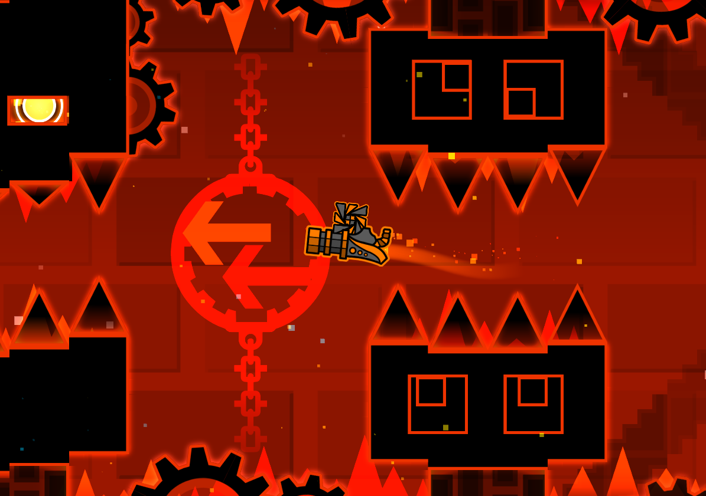
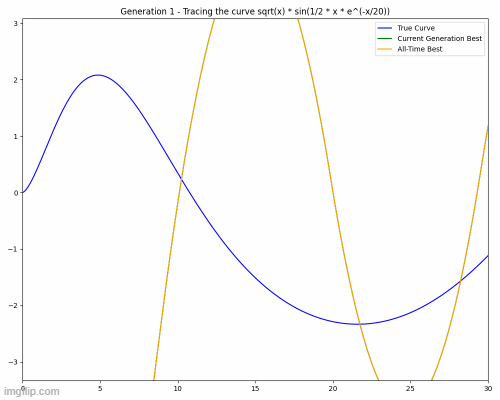

# GDSR

Welcome! If you're wondering what GDSR stands for, it's *Geometry Dash Ship Regression*. Yes, that's what it really is, but what is that, exactly?

## Introducing GD

If you don't know what *Geometry Dash* is, it's a rhythm-platforming game made by RobTop Games, where the player moves forward at a constant speed and must avoid deadly obstacles. For the most part, the game features only one input: clicking (on either a mouse or a key). Depending on the "game mode" being played, that single input has a different effect on the player. The following image shows a particularly famous level, titled *Cataclysm*.

<div align="center">
    
</div>

The one relevant to this project is the *ship* game mode (shown in the image), where clicking causes the player to gain upward thrust, and releasing the key causes the ship to fall down.

## What this actually is

GDSR is a single-variable regression algorithm based on this game mode. It essentially does the following:

- Creates a simulated space (2D plane) where the reference data points are plotted,
- Places a "ship" a bit to the left of all the data points to give it a slight starting margin,
- Makes a neural network control the ship on every tick or "frame" of the simulation (using GD-like controls), deciding whether or not to click,
- And traces the final path to find the regression curve, where the final predicted y-value is obtained.

So, it's a silly and overly convoluted approach to achieve something other algorithms can do more efficiently. Neat!

## One thing

This project was not implemented using `numpy`, `pandas`, or any of those pre-existing structures. Part of my goal with this project was not only to create my own regression algorithm, but also to learn more about neural networks and neuroevolution and to implement all of these concepts from scratch. Thus, running it requires very specific files from this repository and unique variables I'll highlight later.

### Later is now *(Quickstart Guide)*

So, how do we run this thing? It's quite simple; first, you need to import both `GDSR` and `mathstuff`, and then create a regressor using the following command:

```python
from mathstuff import *
from GDSR import *

GD_model = GD_ship_regressor(
    x_values,        # Real x values for training
    y_values,        # Real y values for training (in the same order as the x values)
    gen=100,         # Given that this is a genetic algorithm, this is the amount of networks in a generation
    top=10,          # Amount in a generation that are used for crossover
    resolution=300,  # Amount of ticks or "frames" in the simulation
    scroll=1,        # Multiplier for the scroll speed (horizontal speed) of the ship
    grav=1,          # Multiplier for the force of gravity
    thrust=1,        # Multiplier for the up force
    margin=0.4,      # Multiplier for the additional left margin
    y_margin=1       # Absolute amount of vertical margin
)
```

Then, to train the model, simply run:

```python
GD_model.train(
    gens=500,               # Amount of generations to train
    kill_old=False,         # 'False' means keep the winners in the generation, 'True' means don't let them move on to the next generation
    cross_mode='pairwise',  # Decides how the neural networks are crossed. 'random' means corresponding weights are paired and 'pairwise' uses Euclidean distance to find "better" pairs
    gamma_mode='complete',  # Decides how often they cross and in which order. 'none' means they don't, 'partial' means they either cross over or mutate, 'complete' means they do both
    min_gamma=0,            # Minimum initial chance of crossover occuring
    max_gamma=1,            # Final, "limit-to-infinity" chance of crossover
    gamma_exp=0.01,         # Growth rate for gamma
    debug=False,            # Debug mode
    visualize=False         # Build-in visualizer
)
```

Afterwards, all that's left to evaluate it at a certain x value is to run `GD_model.fire(x)`. `GD_model.fire(2)`, for instance, would return the y-coordinate of the point on the regression curve at $x=2$ (a float).

## How does it work?

It's actually not that hard. If you already know how forward propagation in neural networks works, the rest is simple:

### Small overview of forward propagation

A neuron is a little object made of a few numbers and a function. That's it. Most of those numbers are called "weights", denoted by $w_1, w_2, \dots , w_n$, and the last one is called the "bias", denoted by $b$. The function is called an "activation function", typically with a domain across all real numbers, and we'll call it $act(x)$.

Given $n$ inputs $x_1, x_2, \dots , x_n$, a neuron outputs $act(w_1 \cdot x_1 + w_2 \cdot x_2 + \dots + w_n \cdot x_n + b)$. That's it.

A certain number of neurons are strung together into a "layer". Each neuron in the layer receives the same set of inputs, but they won't necessarily output the same things, as their weights and biases may differ. The layer's output is the list of outputs of all its neurons ($o_1, o_2, \dots , o_k$)

Layers are strung together into a network. The first layer is called the "input layer", which outputs one number for every input you give the network. The neurons in this layer don't really do anything. After the input layer, all those inputs head to the next layer, full of regular neurons. These neurons take those input values and compute their respective outputs. This is called a "hidden layer". Those outputs are then transferred to the next hidden layer, which uses them as its inputs. This is repeated until the final layer is reached, being the output layer, which spits out the final outputs for the network as a whole.

This entire process is called forward propagation, and its final outputs are the result of evaluating the entire neural network.

One nice thing to notice is the purpose of the activation functions: without them, the entire network becomes a simple linear regression. Boring. The functions are there to give the whole thing some variety.

### Neuroevolution

There are actually lots of types of neuroevolution, but I chose a simple version. The idea behind this approach is quite easy to grasp:

- Training things to do complicated stuff is hard, because even I don't know how to teach someone to do them, let alone a computer
- Setting up a proper feedback loop would be difficult
- I'll just let the computer figure it out by pure chance

And, really, that's the core idea. My neuroevolution algorithm creates a pool of, let's say, 100 neural networks, and fills them all with completely random weights and biases. Of course, they're all going to be terrible, but when evaluating their performance, some will be a little better than the others. Because, I mean, even if it's hard to teach someone something, sometimes it isn't very hard to determine whether they've done it right. Anyhow, the top performers in that generation of neural networks are then crossed over, and random mutations are added to their offspring, creating a brand-new generation of 100 neural networks. This process is then repeated many, many times. The whole point is that, by working on the algorithms that seem to be succeeding, we'll eventually reach a network that is incredibly successful. The only downside is we'll never know why it's so good at what it does.

This is almost explicitly what my code does. Only with many added configurations, like decay rates for mutations and slowly growing probabilities for crossover. Seriously, take a look:

```python
# Crossover
other_net = random.choice(self.candidates)  # Select other network to breed the original with
layers1 = new_net.layers
layers2 = other_net.layers
for j in range(len(layers1)):
  if not new_net.layers[j].input:
    l1 = layers1[j]
    l2 = layers2[j]

    if cross_mode == 'random':
      for k in range(len(l1.neurons)):
        n1 = l1.neurons[k]
        n2 = l2.neurons[k]
        for l in range(len(n1.w)):
          alpha = random.random()
          n1.w[l] = alpha * n1.w[l] + (1 - alpha) * n2.w[l]  # Randomly interpolate between both networks' weights and bias
        alpha = random.random()
        n1.b = alpha * n1.b + (1 - alpha) * n2.b

[...]

# Mutation
if can_mutate:
  for layer in new_net.layers:
    if not layer.input:
      for n in layer.neurons:
        for j in range(len(n.w)):
          n.w[j] += self.call_rand() * mult  # Add random variations to weights and bias
          n.b += self.call_rand_b() * mult
new_gen.append(new_net)
```

But then, why do this? It sounds a little lazy after all, given my previous description. That's because it maybe is, but sometimes the easier path is the better one. For other methods like backpropagation, you need to be able to reliably give your model effective feedback so it can correct its weights and biases, but this is not an easy thing to do in many situations.

Consider a problem where feedback isn't immediate, like driving a car. If you make a weird turn at time $t=4s$, that probably won't immediately crash the car on that instant. The model won't get negative feedback from that wrong turn because nothing bad would have happened yet. However, if that mistake caused a crash at $t=5s$, you suddenly need to help the network understand that the mistake had occurred earlier. That isn't what standard backpropagation is designed to do.

That type of learning requires more advanced strategies like Q-learning style networks (adapted for these continuous situations) or deep learning, which are substantially more complex. Neuroevolution offers a much simpler yet still effective way to solve these types of complicated problems without facing the massive design issue of providing accurate reward to the model.

### Making it play GD

After all that, the only thing left is to make the model play the GD ship simulations. What I did for this was make the neural net gather a bunch of points on the curve it traces when flying, done through a quick simulation like this one:

```python
def simulate(self, network):
  x_res = []
  y_res = []

  # Generate important movement variables
  length = max(self.x_values) - min(self.x_values)                      # Length of the system in x units
  height = max(self.y_values) - min(self.y_values) + 2 * self.y_margin  # Length of the system in y units
  dt = 5 / self.resolution                                              # Time per frame (whole path is taken at 5 seconds)
  h_speed = self.scroll * length / 5                                    # Horizontal speed
  g_force = 2 * height * self.grav                                      # Downforce
  up_force = 2 * height * self.thrust                                   # Upforce
  end_dist = max(self.x_values)                                         # Final point in the path

  # Create concurrent moving variables
  y_vel = 0
  y_pos = (max(self.y_values) + min(self.y_values)) / 2
  x_pos = min(self.x_values) - length * self.margin

  # Start movement loop
  while True:
    # Find the next target obstacle's coordinates to feed into the network
    next_x = min(self.x_values) - max(abs(min(self.x_values)), abs(max(self.x_values))) * 100
    next_y = min(self.y_values) - max(abs(min(self.y_values)), abs(max(self.y_values))) * 100
    for i in range(len(self.x_values)):
      # Find next target
      if x_pos < self.x_values[i]:
        next_x = self.x_values[i]
        next_y = self.y_values[i]
        break

    # Fire neural network
    input_arr = [x_pos, y_pos, y_vel, next_x, next_y]
    click = network.fire(input_arr)[0] > 0  # Only click if output is positive

    if click:  # Add thrust if the bot clicked
      y_vel += dt * up_force
      if y_vel > up_force: y_vel = up_force
    else:  # Let it fall if it didn't click
      y_vel -= dt * g_force
      if y_vel < -g_force: y_vel = -g_force

    # Update movement variables
    x_pos += h_speed * dt
    y_pos += y_vel * dt

    # Append result to path
    x_res.append(x_pos)
    y_res.append(y_pos)

    if x_pos > end_dist:  # Check if the path is done
      break

  return (x_res, y_res)  # Return resulting path
```

Notice that, here, we basically feed the network the information of one frame (its x-position, y-position, y-velocity, and the next target) and make it return a split-second decision (positive = click, negative = don't). This is done for all frames, and we get the points on the curve. For all other points in between the calculated ones, we simply interpolate linearly (at a high resolution, this effect is small):

```python
def get_result(self, input, x_res, y_res):
  if input < x_res[0] or input > x_res[-1]:
    raise ValueError("Input must be inside the model's margins.")

  for i in range(len(x_res)):
    if i == 0: continue
    # Find range between frames where the value lives
    if input <= x_res[i]:
      x1 = x_res[i - 1]
      x2 = x_res[i]
      y1 = y_res[i - 1]
      y2 = y_res[i]
      return ((input - x1) / (x2 - x1)) * (y2 - y1) + y1  # Return linearly interpolated value between both closest frames
```

We score models based on SSE (Sum of Squared Errors) for every point in the original training data (comparing the points on the curve with the real ones), and we select the ones with the highest score for crossover and mutation. That's the whole model. Simple, right?

---

And that's about it. If you took the time to read this entire thing, thanks. This was genuinely a really fun project, and I learned quite a bit. And, well, it was a nice surprise when I saw that the model is actually kind of effective.

<div align="center">
    
</div>
